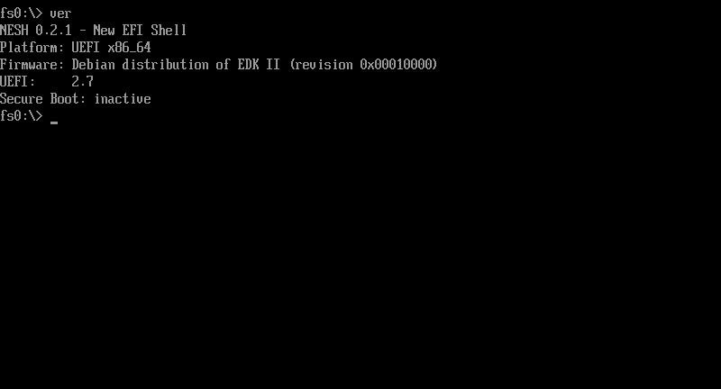

# NESH — New EFI Shell

[](https://github.com/nic-fio/NESH/actions/workflows/ci.yml)
[](LICENSE.md)
[Website, documentation and download](https://nesh.nicfio.it/)

A modern command shell for UEFI firmware, with a real scripting language.
One file, `nesh.efi`: nothing to install, one signature for Secure Boot, no
EDK2 code.



```
fs0:\> map
fs0:\> ls -l \EFI\BOOT
fs0:\> bootmgr add fs0:\EFI\debian\shimx64.efi "Debian" -t
fs0:\> PRINT HEX$(&H1000 * 4)
4000
fs0:\> n = RECORDS(RUN$("map -data"), v$()) : PRINT n; " volumes and disks"
```

## Highlights

- **The UEFI Shell command set, rewritten from scratch**: files, disks, UEFI
  variables, drivers and devices, PCI/SMBIOS/ACPI, memory, network (IPv4 and
  IPv6: `ifconfig`, `ping`, `tftp`, `http`), editors. UEFI Shell options are
  accepted too.
- **NESH BASIC** scripts (`.nsb`): variables, loops, `SUB`/`FUNCTION`, strings,
  arrays, menus, files, and `RUN`/`RUN$` to drive commands.
- **Script-friendly output**: `-data` prints `key=value` records that scripts
  read with `RECORDS` and `FIELD$`.
- **Safe boot management** with `bootmgr`: dry run, confirmation, automatic
  backups, check for missing files. `bcfg` is there too.
- **Runs UEFI Shell applications**: NESH implements `EFI_SHELL_PROTOCOL` 2.2.
- **Friendly prompt**: history with search, Tab completion, aliases, BASIC at
  the prompt.
- **Secure Boot aware**: low-level hardware writes are disabled while Secure
  Boot is active.

## Documentation

| Document | For |
|---|---|
| [User manual](https://nesh.nicfio.it/User%20Manual.html) | Using NESH and writing scripts: every command and function, with examples. |
| [Technical manual](https://nesh.nicfio.it/Technical%20Manual.html) | Architecture, build, internals, testing, how to extend NESH. |
| [Design decisions and history](docs/decisions-and-history.md) | Why NESH is the way it is. |
| [Logo](logos/nesh-logo.png) | The NESH logo (PNG, 2172×724, white background). |

The manuals are HTML pages, so GitHub shows them as source code: read them
online at **https://nesh.nicfio.it/**, or open
`docs/User Manual.html` in a browser from a clone (they work offline). Inside
NESH, `help` and `help NAME` show the same command reference.

## Build and test

Everything needed to rebuild NESH, its documentation, its tests and its disk
image is in this repository: a clone plus a handful of Debian packages is the
whole development environment.

```
git clone https://github.com/nic-fio/NESH.git
cd NESH
tools/setup-dev.sh --install    # packages (asks for sudo) and the git identity
make && make test && make qemu-test
```

[CLAUDE.md](CLAUDE.md) says how the project is worked on: the agreements, the
decisions that are settled and must not be reopened, and what to check before
committing. `tools/backup.sh` packs the whole repository, history and tags
included, into a single file that restores without a network.

Requirements, if you prefer to install them yourself: `gcc`, GNU `ld`, `make`,
`python3`; for the UEFI tests `qemu-system-x86_64`, OVMF firmware and
`mkfs.fat`; for `make usb` also `mtools`; for the Secure Boot tests
`sbsigntool` and `python3-virt-firmware`.

```
make                 # build/nesh.efi (UEFI x86-64) and build/nesh-host (Linux test build)
make test            # language and command tests, documentation checks
make qemu-test       # automated tests inside QEMU/OVMF
make qemu-nettest    # network tests (IPv4 and IPv6) inside QEMU
make qemu            # interactive session in QEMU (serial console)
make usb             # build/nesh-usb.img, a bootable disk image (needs mtools)
```

`OVMF=/path/to/OVMF.fd` selects the firmware image.

## Install

The quickest way is the ready-made disk image from the
[website](https://nesh.nicfio.it/#get)
(`nesh-usb.img`, also `make usb`): write it to a USB stick and boot it.

```
dd if=nesh-usb.img of=/dev/sdX bs=4M conv=fsync    # on Windows: Rufus, balenaEtcher
```

Otherwise, copy `build/nesh.efi` to a FAT-formatted USB stick or EFI system partition,
then either copy it as `\EFI\BOOT\BOOTX64.EFI` to boot it directly from the
firmware boot menu, start it from another shell, or add a boot entry with
`bootmgr add`. With Secure Boot active, sign it with a trusted key first
(see the user manual).

## Reports from real hardware

NESH is tested in QEMU with OVMF. On real machines it has so far only been
started on two — a Chuwi tablet and a server with a Gigabyte motherboard —
where the prompt came up, `dir` listed the files and NESH booted Linux. The
tablet also brought two fixes: Linux no longer crashes when booted from NESH,
and the cursor shows in `edit`. What
AMI, Insyde or Phoenix firmware makes of the rest is the project's main open
question, and the one thing that cannot be settled here. If you start NESH on a
real machine, please say how it went — a machine where everything worked is as
useful a report as one where nothing did: write to **nesh@nicfio.it**.

Four commands collect most of what the report asks, and NESH can write them to
the stick you booted from:

```
ver > fs0:\report.txt
sysinfo >> fs0:\report.txt
map >> fs0:\report.txt
smbiosview -t 1 >> fs0:\report.txt
```

Worth trying, if you have a few minutes: `ls fs0:\`, `map`, `bootmgr` (which
only lists the boot entries until you ask it for a change), `edit` and
`hexedit` on a file you do not mind, one of the scripts in `examples\`, and
`exit` to return to the firmware.

## License

Copyright (c) 2026 Nicola Fiorillo. NESH is **free for any noncommercial
use**: personal use, study, hobby projects, and use by noncommercial
organisations such as schools, charities and public bodies. Its source code is
published under the [PolyForm Noncommercial License 1.0.0](LICENSE.md). For
**commercial use**, including use at work inside a company, write to
**nesh@nicfio.it**. [NOTICE.md](NOTICE.md) has the required notice and the
third-party components, which keep their own licences.

The PolyForm Noncommercial License covers the current version, 0.3.0, too.
Whoever has a copy of version 0.3.0 or of an earlier version may use it, at
their choice, under the licence it was released with or under the PolyForm
Noncommercial License 1.0.0. The earlier licences:

- version 0.3.0: NESH Freeware Licence ([LICENSE-0.3.0](LICENSE-0.3.0));
- versions 0.1.0 to 0.2.1: Apache License 2.0 with the Commons Clause
  ([LICENSE-0.2.1-and-earlier](LICENSE-0.2.1-and-earlier)).
## Status

Version 0.3.0. Tested in QEMU with OVMF, including Secure Boot with test keys.
Started on two real machines, a Chuwi tablet and a server with a Gigabyte
motherboard: the prompt came up, `dir` listed the files, and NESH booted Linux.
Only those steps were tried; the rest of the commands are still verified only
in QEMU — see [Reports from real hardware](#reports-from-real-hardware) above,
and the open questions at the end of the
[decisions document](docs/decisions-and-history.md).
